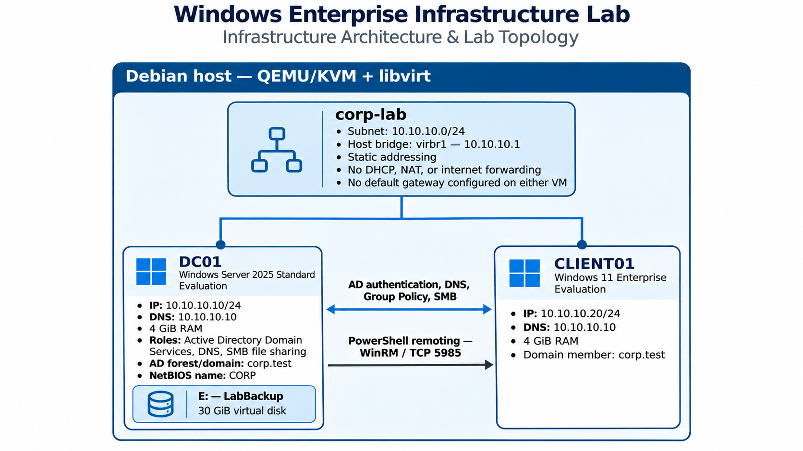

# Windows — Kurumsal Altyapı Projesi

Bu proje, Windows tabanlı bir şirket ağının kurulum ve yönetimini ele alır. Bir Windows sunucusu ve domain'e bağlı bir client bulunur. Proje; Active Directory, DNS, kullanıcı ve bilgisayar yönetimi, Group Policy, dosya paylaşım izinleri, PowerShell ile uzaktan yönetim ve raporlama, yedekleme ve dosya kurtarma işlemlerini kapsar. Sanal makineler, Debian üzerinde QEMU/KVM ve libvirt ile dış ağlara kapalı bir sanal ağda çalışır.

## ISO Dosyaları

| VM | Evaluation ISO |
|---|---|
| DC01 | [Windows Server 2025](https://www.microsoft.com/en-us/evalcenter/download-windows-server-2025) |
| CLIENT01 | [Windows 11 Enterprise](https://info.microsoft.com/ww-landing-windows-11-enterprise.html) |

[Mimari ve dizin yapısı](docs/architecture.md)

## Test Sonuçları

| Alan | Sonuç |
|---|---|
| AD DS ve DNS | corp.test forest'ı; DNS üzerinden domain controller sorgusu ve dcdiag kontrolleri başarılı |
| Domain üyeliği | CLIENT01, corp.test domain'ine üye; Ali'nin domain oturumu ve erişim token'ındaki Engineering grup üyeliği geçerli |
| Group Policy | Kullanıcı kısıtlamasının uygulanması ve kaldırılması başarılı; WinRM bilgisayar policy'si etkin |
| Dosya paylaşımı | Ali için dosya okuma, yazma ve silme erişimi var; Mehmet'in erişimi yok |
| Uzaktan yönetim | Kimlik doğrulamalı komut çalıştırma ve servis durdurma/başlatma işlemleri başarılı |
| Raporlama | Domain bilgisayar envanteri, kullanıcı raporu filtreleri, CSV dışa aktarma ve içe aktarma testleri başarılı |
| Yedekleme ve kurtarma | System State yedeği mevcut; 29 policy dosyasının kurtarma testi başarılı |

## Environment

| Bileşen | Yapılandırma |
|---|---|
| Active Directory | Bir forest, bir domain ve bir domain controller |
| Ağ | Dış ağlara yönlendirme yapmayan izole sanal subnet |
| Kurtarma testi | SYSVOL policy dosyalarının farklı bir konuma geri yüklenmesi |
| Yedek depolama | Aynı fiziksel makine üzerindeki ayrı sanal disk |

## Sanallaştırma

- [Sanal ağ](virtualization/README.md)
- [DC01 kurulumu](virtualization/dc01.md)
- [CLIENT01 kurulumu](virtualization/client01.md)

## Windows Ağ Yapılandırması

- [DC01 statik IP ve DNS yapılandırması](windows-networking/README.md)
- [İstemci ağ yapılandırması ve domain üyeliği](windows-networking/domain-join.md)

## Active Directory

- [Domain controller kurulumu](active-directory/README.md)
- [Engineering kullanıcıları ve güvenlik grubu](active-directory/engineering.md)
- [Bilgisayar hesaplarının OU yapısı](active-directory/computer-organization.md)

## Group Policy

- [Engineering kullanıcı policy'si](group-policy/README.md)

## Dosya Paylaşımı

- [Engineering dosya paylaşımı](file-sharing/README.md)

## PowerShell

- [Kurulum ve doğrulama script'leri](powershell/README.md)

## Yönetim ve Raporlama

- [PowerShell ile uzaktan yönetim](docs/remote-administration.md)
- [Domain bilgisayar envanteri](docs/inventory.md)
- [Domain kullanıcı raporu](docs/user-report.md)

## Yedekleme ve Kurtarma

- [System State yedeği ve dosya kurtarma](backup-recovery/README.md)

## Güvenlik

- [Güvenlik kontrolleri](docs/security-status.md)
