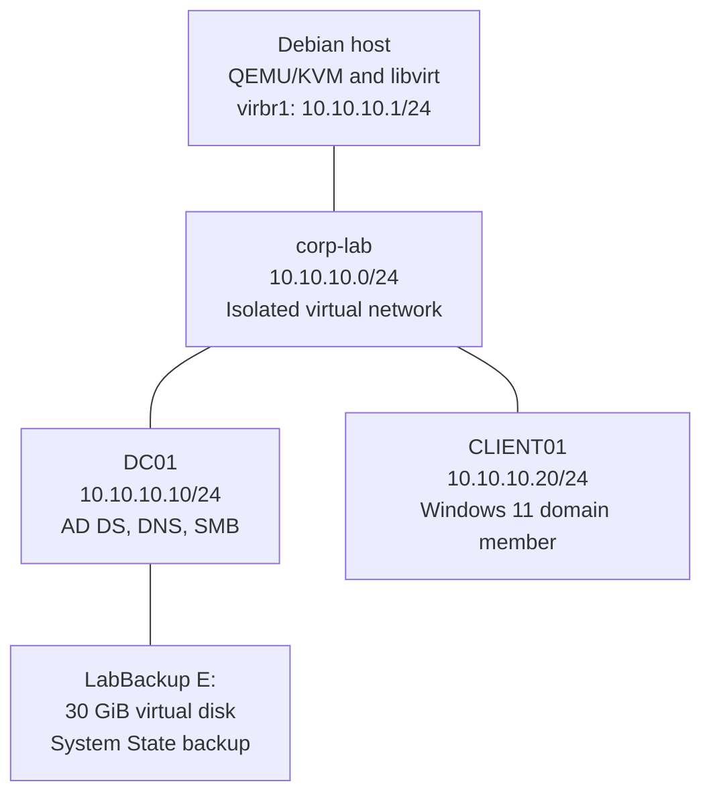

# Lab architecture

Two Windows VMs run on a Debian QEMU/KVM host. The isolated libvirt network provides connectivity between the host and guests without DHCP, libvirt DNS, NAT, or external forwarding.



| Component | Configuration |
|---|---|
| AD forest and domain | `corp.test` |
| NetBIOS domain name | `CORP` |
| DC01 OS | Windows Server 2025 Standard Evaluation, Desktop Experience |
| CLIENT01 OS | Windows 11 Enterprise Evaluation |
| Guest RAM | 4 GiB per VM |
| Guest DNS | `10.10.10.10` |
| Guest default gateway | None |
| Share | `\\DC01\Engineering` |

## Directory layout

```text
corp.test
├── Domain Controllers OU
│   └── DC01
├── PCs OU
│   └── CLIENT01
├── Engineering OU
│   ├── Ali (ali)
│   └── GG_Engineering
└── Users container
    └── Mehmet (mehmet)
```

`Engineering-User-Policy` is linked to Engineering; `PCs-WinRM` is linked to PCs.

