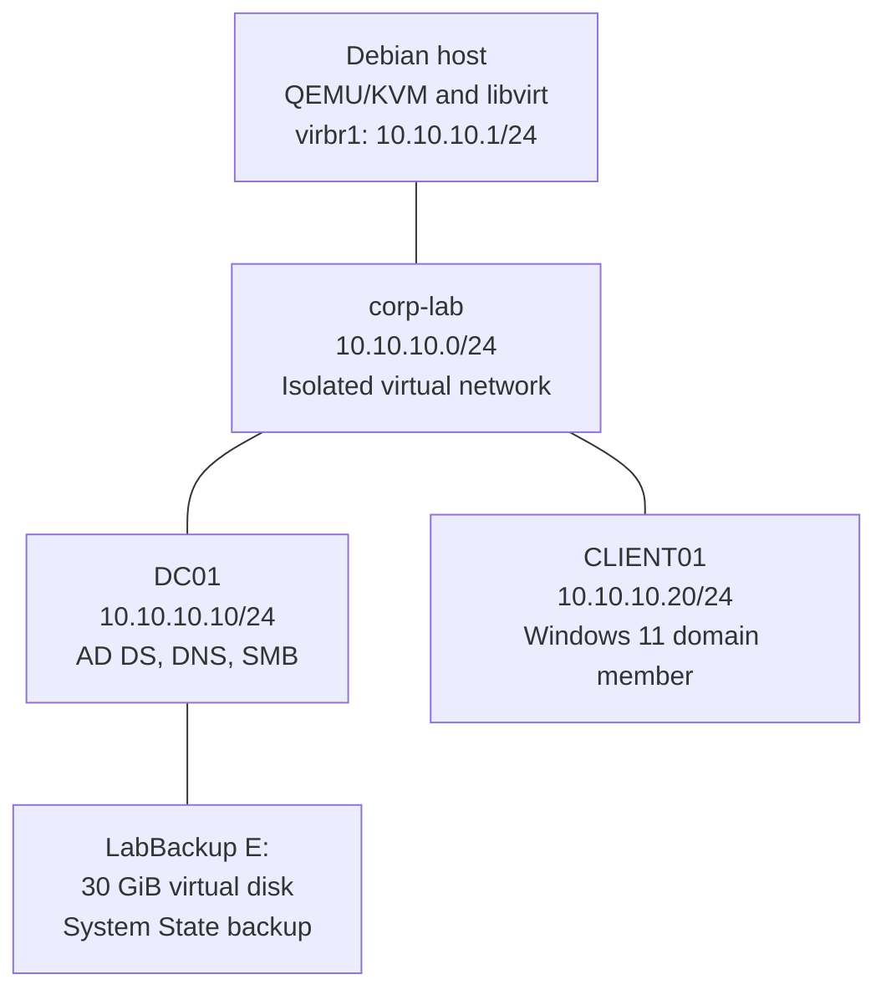

# Altyapı Mimarisi

İki Windows sanal makinesi, Debian üzerinde QEMU/KVM ile çalışır. İzole libvirt ağı, host ve sanal makineler arasındaki bağlantıyı sağlar. DHCP, libvirt DNS, NAT ve dış ağlara yönlendirme kapalıdır.



| Bileşen | Yapılandırma |
|---|---|
| AD forest ve domain | `corp.test` |
| NetBIOS domain adı | `CORP` |
| DC01 işletim sistemi | Windows Server 2025 Standard Evaluation, Desktop Experience |
| CLIENT01 işletim sistemi | Windows 11 Enterprise Evaluation |
| Sanal makinelerin RAM kapasitesi | Her VM için 4 GiB |
| Sanal makinelerin DNS sunucusu | `10.10.10.10` |
| Default gateway | Yok |
| Dosya paylaşımı | `\\DC01\Engineering` |

## Active Directory Yapısı

```text
corp.test
├── Domain Controllers OU
│   └── DC01
├── PCs OU
│   └── CLIENT01
├── Engineering OU
│   ├── Ali (ali)
│   └── GG_Engineering
└── Users container
    └── Mehmet (mehmet)
```

Engineering organizasyon birimine `Engineering-User-Policy`, PCs organizasyon birimine `PCs-WinRM` bağlıdır.
